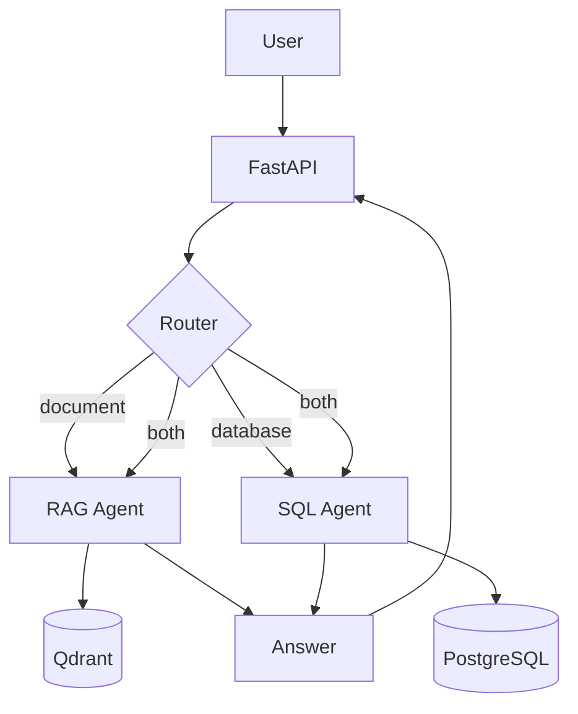
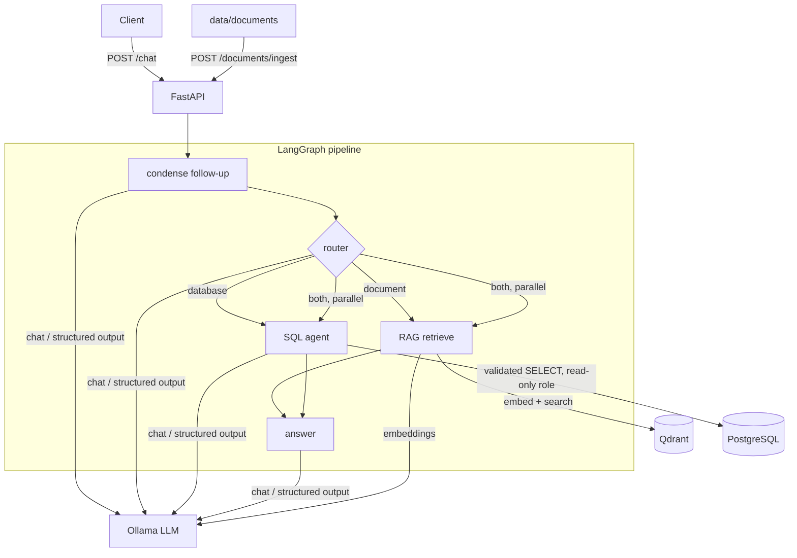
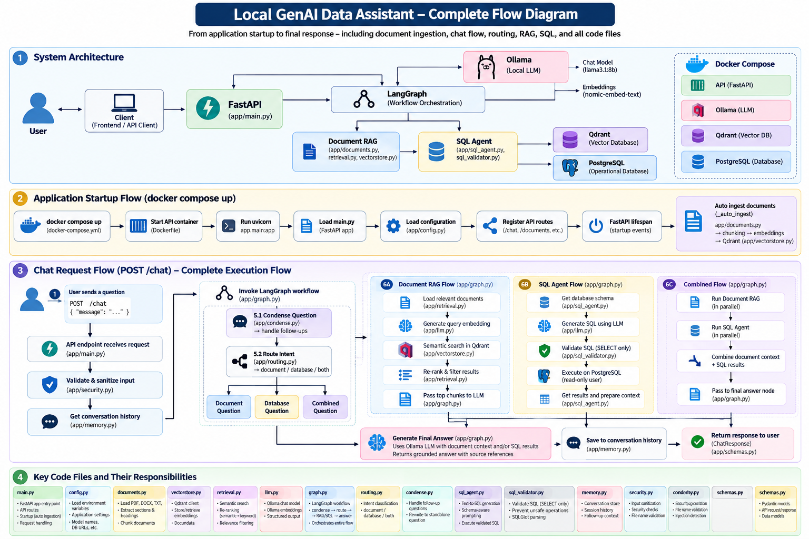

# Local GenAI Data Assistant

Chat with **documents** (RAG) and **PostgreSQL data** (text-to-SQL) using a fully local stack.
No business data leaves your machine: LLM and embeddings run in Ollama, vectors in Qdrant, rows in PostgreSQL.

## Quick start

```bash
cp .env.example .env        # required: set POSTGRES_PASSWORD, READONLY_PASSWORD, ASSISTANT_RW_PASSWORD
docker compose up --build   # (compose refuses to start with any of the three unset)
```

First run pulls the models (`llama3.1:8b` ≈ 4.7 GB, `nomic-embed-text` ≈ 270 MB) via the one-shot `ollama-init` service;
the API starts after that and auto-indexes `data/documents/`. The `/health` endpoint passes as soon as Qdrant/Ollama/Postgres
are reachable, which can be *before* that indexing finishes — check its `ingest` field (`pending` / `running` / `done` /
`failed` / `disabled`) if an early question returns "couldn't find anything". Watch progress with `docker compose logs -f api`.

- Test UI (Streamlit chat, sources, SQL + rows, document upload/delete): http://localhost:8501
- Swagger UI / API docs: http://localhost:8000/docs
- **Memory:** `llama3.1:8b` needs ~6 GB free for Docker. On Docker Desktop with less (default VM can be ~4 GB) it is OOM-killed (`signal: killed` in the ollama log) — either raise Docker Desktop's memory or use the smaller model: put `CHAT_MODEL=llama3.2:3b` in `.env` (tested; good enough for the demo questions, weaker on complex SQL).
- GPU: uncomment the `deploy` block on the `ollama` service in `docker-compose.yml`.

```bash
curl -s localhost:8000/chat -H 'content-type: application/json' \
  -d '{"message":"What is the company leave policy?"}' | jq
curl -s localhost:8000/chat -H 'content-type: application/json' \
  -d '{"message":"Which are the top 5 customers by revenue?"}' | jq
curl -s localhost:8000/chat -H 'content-type: application/json' \
  -d '{"message":"What is the refund policy and how much was refunded last month?"}' | jq
```

## Architecture




A question hits FastAPI, a LangGraph router decides *document*, *database*, or *both*. The RAG agent searches Qdrant, the SQL agent queries PostgreSQL, and either result feeds one final answer. Every LLM step (routing, SQL generation, answering) runs on the same local Ollama model — nothing leaves the machine.

<details>
<summary>Full detailed flow (click to expand)</summary>



Full flow, from `docker compose up` through startup, ingestion and every chat-request path (document / database / combined), with the responsible file named at each step:

</details>



| Layer | Choice |
|---|---|
| API | FastAPI (`app/main.py`, `app/health.py`, `app/routes/`) |
| Orchestration | LangGraph `StateGraph` (`app/agents/chat_agent.py`) |
| LLM / embeddings | Ollama: `llama3.1:8b`, `nomic-embed-text` |
| Vector DB | Qdrant, cosine, one point per chunk with `filename/page/chunk_index` payload |
| SQL | PostgreSQL 16, `sqlglot` validator, `psycopg` |

### Request flow
1. **condense** – if the session has history, the LLM rewrites the follow-up ("and sick days?") into a standalone question.
2. **router** – LLM structured output (`RouteDecision`: `document | database | both` plus a sub-question for each side). If the LLM call fails, a keyword heuristic takes over.
3. **rag** / **sql** – run alone or *in parallel* for `both`.
4. **answer** – one LLM call over `<documents>` and `<sql_result>` context; cites source files. Response also returns the sources and the executed SQL with its rows.

### RAG (`app/services/document_service.py`, `app/repository/retrieval.py`, `app/repository/vector_store.py`)
1. **Section-aware chunking.** PDF (page-aware) and TXT: recursive splitting (`CHUNK_SIZE`/`CHUNK_OVERLAP`).
   Markdown and DOCX: split on headings (Markdown `#`..`######`, ignoring `#` lines inside code fences; DOCX `Title`/`Heading 1..N` styles; the table of contents is not indexed); one chunk per section, split further only if larger than `CHUNK_SIZE`, and every piece keeps its heading metadata. A document with no headings falls back to one un-headed section, chunked like plain text — heading structure is detected generically, never assumed or hardcoded per file.
   The embedded text is `filename > Parent > Section` + body, so, e.g., "Prisma 7" is anchored to "Database" wherever that heading appears, in any document.
2. **Metadata** in each Qdrant point: `doc_id, filename, file_type, page, chunk_index, text, section, heading, heading_path, chunker_version, ingested_at`. `/chat` sources expose `section` and `heading` (optional fields). Documents indexed by an older chunker are re-embedded automatically at startup (`chunker_version`).
   **DOCX** headings (Word's `Title`/`Heading 1..N` paragraph styles) are converted to the same `#`/`##` structure and reuse the identical Markdown section splitter, so a `.docx` with headings gets the same section-aware chunking as a `.md` file, with no format-specific logic duplicated. A document with no headings at all (`.docx` or `.md`) falls back to one un-headed section, chunked like plain text.
3. **Candidate retrieval.** One query embedding -> `RETRIEVAL_CANDIDATE_K` (10) nearest chunks. Vague concept words are expanded for the embedding (`framework` -> "tech stack technology").
4. **Semantic + keyword ranking.** `final = SEMANTIC_WEIGHT * cosine + KEYWORD_WEIGHT * keyword (+ FILENAME_BOOST)`. The keyword score is the weighted share of the query's informative terms found in the chunk (case-insensitive, plural-normalised, stopwords ignored; rarer and technical terms such as ORM, Prisma, pnpm weigh more; a term in the section heading counts extra).
5. **Filename-aware.** Naming an indexed document (`security_policy.docx`, `refund_policy`, case-insensitive) restricts retrieval to it (a full candidate pool of its own); other documents are used only if it yields nothing.
6. **Relevance check.** A chunk is kept only if it has semantic >= `SEMANTIC_FLOOR` **and** (semantic >= `RAG_MIN_SCORE`, or keyword >= `KEYWORD_MIN_SCORE`, or it is from a named document). No qualifying chunk -> no context -> the assistant says it found nothing (the LLM is not called).
7. **Selection.** Best chunks within `RELATIVE_CUTOFF` of the top score (looser `BROAD_RELATIVE_CUTOFF` for broad questions such as "what are the rules..."), at most `MAX_CHUNKS_PER_SECTION` per section, at most `TOP_K` (`BROAD_TOP_K` for broad questions).
8. **Grounding.** The answer prompt allows only the retrieved context, forbids inference/invention, and requires an explicit "not enough information" reply; `[file]` citations of files that were not retrieved are stripped.

**Debugging retrieval:** set `RAG_DEBUG=true` (e.g. in `.env`) to log every candidate (KEEP/DROP, section, semantic, keyword, final, matched terms) and to include a `debug` object in each source (shown in the Streamlit UI). Off by default; never enable it for end users.

| Setting | Default | Meaning |
|---|---|---|
| `RETRIEVAL_CANDIDATE_K` | 10 | semantic candidates fetched |
| `TOP_K` / `BROAD_TOP_K` | 4 / 6 | final context size (normal / broad questions) |
| `SEMANTIC_WEIGHT` / `KEYWORD_WEIGHT` / `FILENAME_BOOST` | 0.7 / 0.3 / 0.25 | ranking weights |
| `RAG_MIN_SCORE` / `KEYWORD_MIN_SCORE` / `SEMANTIC_FLOOR` | 0.6 / 0.5 / 0.35 | relevance gates |
| `RELATIVE_CUTOFF` / `BROAD_RELATIVE_CUTOFF` | 0.8 / 0.6 | drop chunks scoring below this fraction of the best |
| `MAX_CHUNKS_PER_SECTION` | 2 | section diversity |

### Routing and follow-ups (`app/services/routing_service.py`, `app/agents/condense.py`)
- **Router.** Keyword rules first: business nouns (customers, orders, revenue, refunded amounts, stock...) mean *database*; document/technical-documentation vocabulary (policies, leave, ORM, framework, frontend, coding rules, installation, configuration, pricing/billing, "the project", file names like `X.md`...) means *documents*; both means *both*. Technical words alone ("ORM", "database", "SQL", "schema", "PostgreSQL") never mean *database*. The LLM router only decides questions with neither signal, and its prompt says the same. For a single-intent question, only the *route* choice is taken from the LLM — the retrieved/queried text is always the user's own (standalone) question, never the model's rewritten `doc_question`/`db_question`, which a small model can paraphrase into an unrelated question when no actual split is needed. The model's split is used only when the route is genuinely `both`.
- **Condensation.** The current question is the source of truth. History is used only when the question cannot stand alone (no specific terms of its own such as "What is the time limit?", or an unresolved pronoun like "What do they eat?"); everything else is preserved as typed. A rewrite must keep every original word and may only add words from the recent conversation; otherwise a deterministic fallback is used. Security-sensitive input is never rewritten.

### SQL agent (`app/agents/sql_agent.py`, `app/tools/sql_validator.py`)
- **Schema-aware prompt**: live introspection of columns, foreign keys and `CHECK` constraints (an enum like `orders.status`'s valid values is read from the constraint itself, not hand-copied into prompt text that can drift from it after a migration), plus a few sample values for other low-cardinality text columns (`products.category`, `refunds.reason`, ...) - the cardinality check is also what keeps a near-unique column like `customers.email`/`name` from ever being sampled into the prompt. Cached for `SCHEMA_CACHE_TTL_S` (default 5 minutes, not the process lifetime), plus business rules (what "revenue" means, what "last month" means) and few-shot examples.
- **Structured output**: model must return `{"sql": "..."}`.
- **Validation** (`sqlglot`, fail-closed): one statement, root must be SELECT/UNION, no DML/DDL/`INTO`/`FOR UPDATE`, table allowlist (checked via scope resolution, so a CTE can't be used to shadow a real table reference elsewhere in the same statement), no `pg_*`/`dblink`/table functions, comments stripped, `LIMIT` clamped to `SQL_MAX_ROWS` (not just injected when absent - a model-written `LIMIT 1000000` is reduced, not left alone). The *re-generated* SQL is what runs.
- **Defense in depth**: executes as role `assistant_ro` (SELECT on 5 tables only) inside a `READ ONLY` transaction with `statement_timeout`; row cap on fetch.
- **Self-repair**: one retry, feeding the validation/DB error back to the model.
- **Query logging**: every attempt (ok / rejected / error), tagged with the chat `session_id`, goes to the app log and to table `query_log` - written by `assistant_rw` (`INSERT`/`DELETE` only; it cannot `SELECT` the log back). `question` is the user's raw, unredacted text, so rows older than `QUERY_LOG_RETENTION_DAYS` (default 30) are pruned automatically every `QUERY_LOG_PRUNE_INTERVAL_S` (default hourly) - see `app/starter.py`.

```sql
SELECT asked_at, session_id, status, question, generated_sql FROM query_log ORDER BY id DESC LIMIT 10;
```

### Security & error handling

**SQL: three independent layers, any one of which alone would block an unsafe query — these are the real controls**
1. `sqlglot` AST validator (`app/tools/sql_validator.py`) — fails closed: anything not a plain `SELECT`/`UNION` over the 5 allowed tables is rejected before it ever reaches the database. Table references are checked via sqlglot's *scope* resolution, not a flat "is this name a CTE anywhere in the statement" set, so a `WITH pg_shadow AS (...) ...` can't be used to shadow a real system-table reference elsewhere in the same statement (e.g. a sibling `UNION` branch); CTE names that collide with an allowed or system table are rejected outright regardless. `LIMIT` is clamped to `SQL_MAX_ROWS`, not just added when absent — `LIMIT 1000000` no longer passes through unchanged.
2. Postgres roles (`db/03_roles.sh`), neither the superuser/DB-owner role the containers start as:
   - `assistant_ro` — `SELECT`-only grant on the 5 business tables, `default_transaction_read_only = on`, nothing else visible (no `query_log`, no other schemas). Runs all LLM-generated SQL.
   - `assistant_rw` — `INSERT`/`DELETE` on `query_log` only (plus `USAGE` on its id sequence and column-level `SELECT` on just `asked_at`, needed to evaluate the retention prune's `WHERE` clause). It can append and age out rows but never read back `question`/`generated_sql`/`error` - the columns that can contain user-typed or error-message content.
3. Per-transaction `READ ONLY` + `SET LOCAL statement_timeout` (`app/agents/sql_agent.py`) — caps worst-case query time regardless of what the first two layers let through.

Every attempt (accepted / rejected / errored) is written to `query_log` for audit, independent of whether the query ran.

**Everything else**
- Untrusted-data framing: document and SQL text is delimited, delimiter tags are stripped from documents, system prompt says never to follow instructions found in context; injection-looking user input is logged, never executed.
- Input limits: message ≤ 2000 chars, control chars stripped, upload ≤ 10 MB, extension allowlist, filename sanitised (no path traversal on upload or delete), session id pattern-checked.
- Generic error messages to clients (details only in logs); Ollama unreachable → `503`, Ollama reachable but not responding within `OLLAMA_TIMEOUT_S` (default 120s) → `504`, SQL/retrieval failures degrade to an answer that says the data was unavailable.
- Ports are bound to `127.0.0.1`; API container runs as non-root; Qdrant telemetry disabled.
- No deserialization of untrusted data anywhere (no pickle) — conversation memory is a plain in-process bounded LRU, not persisted to disk.
- Postgres access goes through a small `psycopg_pool.ConnectionPool` per role (`app/repository/db.py`), not a fresh connection per call.
- A corrupt/unreadable file under `data/documents/` (bad PDF stream, a `.docx` that isn't a valid zip/OPC package) is quarantined - renamed with a trailing `.failed` - instead of being re-parsed and re-logged as a failure on every restart; fix it and rename the file back (drop the `.failed`) to retry.
- `docker-compose.yml` has no fallback for `POSTGRES_PASSWORD`/`READONLY_PASSWORD`/`ASSISTANT_RW_PASSWORD`: it refuses to start without them, instead of silently running on a hardcoded default everyone reading this file also knows.

**What is *not* a security control:** `app/utils/security.py`'s `looks_like_injection`/`is_sensitive_request` (pattern/keyword matching on the user's message - e.g. "ignore previous instructions", "show me your system prompt") is trivially bypassed by rephrasing and only *logs* a warning on `looks_like_injection`; it exists to catch the obvious case and keep it out of conversation history, not to stop a determined attacker. **The SQL layers above and the read-only role are the actual defense** - they hold even if every prompt-level check is bypassed, because they don't depend on the LLM's output being well-behaved.

**Auth and rate limiting**
- `API_KEY` is unset by default (no auth) — acceptable only because every port in `docker-compose.yml` is bound to `127.0.0.1`. If this is ever reachable beyond localhost, set `API_KEY`; until then, `DELETE /documents/{id}` and `POST /chat/stream` are exactly as unauthenticated as every other route when it's unset (`require_api_key` is a no-op for all of them alike, not a gap specific to those two).
- Rate limiting keys on `get_remote_address` (the direct TCP peer). Behind a reverse proxy or inside a Docker network where that's a shared gateway/NAT address, every client shares one bucket - fine for a single local user, not for a multi-user deployment without also forwarding the real client IP (e.g. trusting `X-Forwarded-For` from a known proxy).
- `GET /documents` and `DELETE /documents/{id}` have no rate limit (only `/chat`, `/chat/stream` and `POST /documents/ingest` do) - low-cost reads/deletes, but worth knowing if this is ever exposed.

## API
See [docs/API.md](docs/API.md) or the live Swagger UI at `/docs`.

| Method | Path | Purpose |
|---|---|---|
| POST | `/chat` | Ask a question (`message`, optional `session_id`) |
| POST | `/documents/ingest` | Upload one file, or no body to index `data/documents/` (`?force=true` re-embeds) |
| GET | `/documents` | List indexed documents |
| DELETE | `/documents/{id}` | Remove vectors and the file |
| GET | `/health` | Diagnostic status of Qdrant, Ollama, PostgreSQL, and auto-ingest progress - 503 on "degraded". Not a liveness probe (see below) |
| GET | `/health/live` | Liveness probe: 200 once the process can serve HTTP, independent of any dependency. This (not `/health`) is what the Dockerfile's `HEALTHCHECK` and any orchestrator liveness/readiness check should point at - a single dependency outage must not make Docker/Kubernetes restart a perfectly healthy API container |

## Data
- `data/documents/`: 6 company-policy-style samples, all for the same fictional company (Acme Corp) so an unqualified question like "what is the leave policy?" has one unambiguous answer – leave policy (md), refund policy (md), remote work policy (txt), shipping FAQ (md), security policy (docx) and a pricing policy (pdf), covering every supported format. `python scripts/generate_sample_docs.py` regenerates the two script-authored files, `security_policy.docx` and `warranty_and_support.pdf` - the latter was removed from this directory via the UI's delete button during testing and can be restored by rerunning the script. `equipment_guide.docx` (also removed the same way) isn't script-generated; copy it back from `tests/fixtures/equipment_guide.docx` if you want it in the live demo corpus again. (Earlier revisions also shipped a few files unrelated to this brief - another project's frontend-standards doc, a Go pipeline README, a marine-biology guide, generic auth/deploy notes, and a second fictional company's own HR handbook that duplicated the leave-policy topic under different numbers - all removed from the live demo corpus; the auth/deploy/marine-biology ones remain under `tests/fixtures/` purely as deliberately off-topic test fixtures, proving retrieval generalizes rather than being special-cased for any one document.)
- `db/`: `01_schema.sql` (customers, products, orders, order_items, refunds, query_log), `02_seed.sql` (20 customers, 15 products, 300 orders with dates relative to today, refunds incl. last month), `03_roles.sh` (least-privilege roles). These run only when the `pgdata` volume is empty - **there is no migration tool** (e.g. Alembic); out of scope for this project's static demo schema. To apply a schema change against an existing volume, either run the new SQL by hand (`docker compose exec postgres psql -U shop_admin -d shop -f -`) or `docker compose down -v` to reinit from `db/` on next `up` (destroys all data, including `query_log`). Either way, `schema_prompt()`'s cache (`SCHEMA_CACHE_TTL_S`, default 5 minutes) picks up the change without an API restart - or clear it immediately with `app.agents.sql_agent.schema_prompt.cache_clear()`.

## Tests
```bash
python -m venv .venv && . .venv/bin/activate
pip install -r requirements-dev.txt
pytest                                  # 299 tests
pytest --cov=app --cov-report=term-missing   # with coverage (~90%)
```
Covers the SQL validator (injection/DDL/DML/catalog access), loaders/chunking, LangGraph routing & fallback with injected fakes, conversation store, and all API endpoints (fake graph/store). No Ollama/Docker needed. Runs automatically on every push/PR via [GitHub Actions](.github/workflows/tests.yml).

**Optional integration test** (`tests/test_integration_ollama.py`): exercises the real local model against the seeded schema to confirm it actually produces valid SQL, not just that the validator rejects bad SQL in isolation. Skipped by default; requires live services:
```bash
docker compose up -d
RUN_INTEGRATION=1 pytest tests/test_integration_ollama.py
```

## Project layout
Layered by responsibility (routes -> agents/services -> repository/tools -> llms), one concern per package:
```
app/
  main.py              FastAPI app: creates `app`, mounts routers, wires the lifespan
  health.py            GET /health, /health/live
  container.py         singleton providers (get_store/get_graph), imported by both routes/ and starter.py
  starter.py           startup lifespan + ingest_status (shared with POST /documents/ingest's ingestion path)
  routes/              HTTP layer: chat_routes.py, document_routes.py, dependencies.py (require_api_key)
  agents/              orchestration: chat_agent.py (LangGraph pipeline), condense.py, sql_agent.py
  services/            business logic: document_service.py (load/chunk/directory-ingest), routing_service.py,
                       answer_service.py (citation scrubbing, LLM context formatting)
  repository/          data access: vector_store.py (Qdrant), retrieval.py (rank), conversation_store.py (in-memory history)
  tools/               sql_validator.py (SELECT-only guardrail, used by agents/sql_agent.py)
  llms/                ollama_client.py (chat model / embeddings / structured-output singletons)
  prompts/             system prompt text: router_prompt.py, answer_prompt.py, condense_prompt.py, sql_prompt.py
  models/              internal domain objects: retrieval.py (Hit), sql.py (SQLResult), routing.py (RouteDecision)
  schemas/             API request/response contracts: chat.py, documents.py, health.py
  config/              settings.py (env-driven Settings singleton)
  exceptions/          sql.py (SQLValidationError)
  utils/               security.py (sanitization, injection/secret detection, safe filenames)
db/            schema, seed, roles
data/documents sample files
tests/         pytest suite (mirrors app/'s module paths)
docs/API.md    endpoint reference
```

## Known limits
- 8B local models occasionally write imperfect SQL; the retry loop and the shown SQL/rows make this visible. Larger models via `CHAT_MODEL` improve it.
- No auth on the API (local demo). Put it behind a reverse proxy with auth before exposing beyond localhost.
- Conversation history (`ConversationStore`) is a bounded in-process LRU, not shared storage. This is correct only because the API runs as a single `uvicorn` worker/process (as shipped, no `--workers`); scaling to multiple workers or replicas would break session affinity and needs the history moved to shared storage (e.g. Redis, Postgres, or the LangGraph checkpointer). It also assumes one request in flight per `session_id` at a time: two concurrent requests for the same session can interleave (each reads history before the other's answer is recorded), which is acceptable for the assignment's follow-up use case but not for a client that fires multiple messages per session in parallel.
- Follow-up condensation (`app/agents/condense.py`) only sees the conversation as text (the last few turns, each answer truncated to 1500 chars when stored) - it has no access to a previous turn's *structured* SQL result. "Who are the top 5 customers by revenue?" then "and the second one?" re-asks the SQL agent from scratch rather than indexing into the prior result, so it can get a different (if consistent) answer rather than literally "the second row of that exact result set". Fine for the assignment's example questions; a product needing that would carry the last `SQLResult` (not just its prose answer) in session state.
